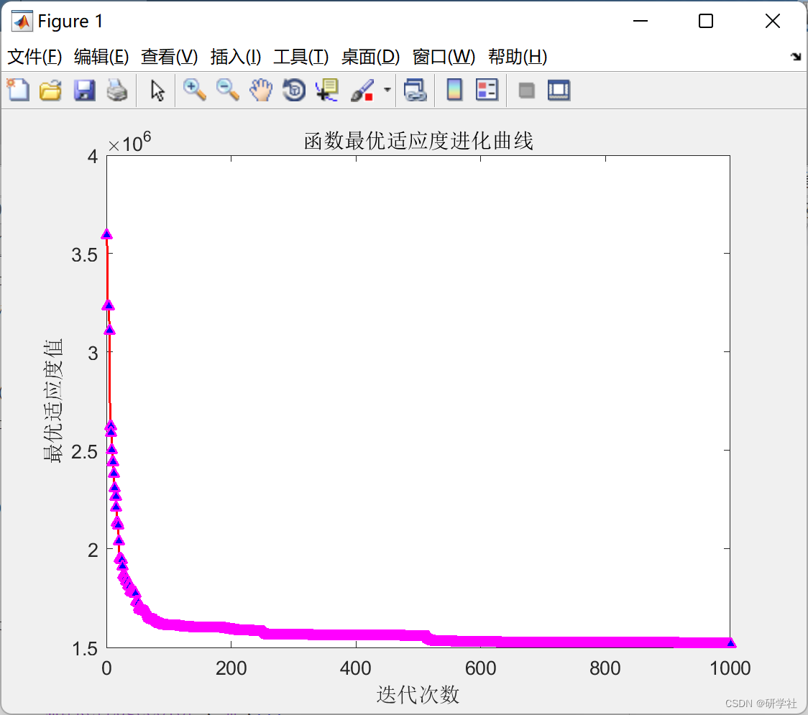

# Optimization of the Combined Energy System for Cogeneration Based on Particle Swarm Optimization Algorithm (Matlab Code Implementation)

Edit:

1. Existing energy systems are often planned and operated independently, leading to low energy utilization and high pollution. Nowadays, people are more interested in how to optimize the collaborative operation of various independent energy supply systems to reduce environmental pollution while increasing energy utilization and economic efficiency. [2]

The large-scale integration of various types of energy has often made it difficult for energy systems to balance economic and environmental aspects, resulting in insufficient optimization capabilities. Therefore, how to optimize comprehensive energy systems to balance their economic and environmental performance has become a problem that needs to be addressed. [3]

Peng Wei et al. [4,5] utilized linear models to optimally allocate capacities for power, natural gas, and thermal systems, enhancing the system's energy utilization efficiency; literature [6-9] considered carbon emissions and the absorption of renewable energy, proposing a new hybrid flow calculation method to ensure the economic and stable operation of a combined cooling, heating, and power (CCHP) microgrid. A goal function was established based on the optimal economic and environmental performance of the system, and constraints were constructed to establish an optimization model for a CCHP system; the particle swarm optimization algorithm was improved to solve the system optimization model; finally, results were analyzed through case studies, studying the operational outcomes of the system under single objective and multi-objective considerations, providing references for the later collaborative planning of comprehensive energy systems.
📚2 Operational Results
Partial code:
FG = zeros(1, 24); % The consumed gas volume of the gas turbine at time t
FBoi = zeros(1, 24); % The consumed fuel volume of the boiler at time t
h = zeros(1, 24);  
FE = zeros(1, 24); % The total amount of gas used
yBoi = 0.85; % The heat efficiency of the boiler
ygg = zeros(2, 24); % The power generation efficiency corresponding to the ith gas generator
D = 8;  
PG = zeros(1, 24); % The electricity exchanged with the main grid
HJ = zeros(1, 24); % CO2 emission amount
ue = 0.872; % CO2 emission coefficient per unit power
uf = 5.42; % CO2 emission coefficient per unit volume
W = 0.004125;% penalty coefficient, including emission penalty and environmental value
CE = zeros(1, 24);% energy interaction cost between the main grid and t-period
Rr = zeros(1, 24);% storage electricity price
fa = 100; R = 0.034;% gas-to-electricity conversion coefficient
Pwind=[11160,12410,12140,12590,12410,11320,10040,10536,8230,9004,8050,8320,8878,8500,8230,8680,9482,9500,1770,11518,11068,11860,11140,8700]; % wind turbine power
PD=[2800,2700,3000,3800,4600,4600,5200,5400,5800,6300,7400,8700,9700,10000,10100,10300,9000,7000,6700,5900,4500,3000,2700,2800]; % predicted system required electric power for different periods of a day
Ppv=[0,0,0,0,0,0,1650,2450,3250,3350,3400,3750,3450,3250,3200,2400,2100,1300,0,0,0,0,0,0]; % Photovoltaic power of the photovoltaic generator
Aa=8.935;Bb=33.157;Cc=-27.081;Dd=17.989;% Here, Aa, Bb, Cc, Dd correspond to the power generation efficiency of four different gas generators respectively.
PGnom1=1200;PGnom2=2800;% The base power value is 1200 and 2800.
Copac=0.80;Copec=3;  
%-------------%  
for t=1:24  
ygg(1, t) = (Aa + Bb * (X((t-1)*D+1)/PGnom1) + Cc * (X((t-1)*D+1)/PGnom1)^2 + Dd * (X((t-1)*D+1)/PGnom1)^3) / 100; %X((t-1)*D+1) represents the electrical power of the gas generator at the corresponding time.
ygg(2,t)=(Aa+Bb*(X((t-1)*D+2)/PGnom2)+Cc*(X((t-1)*D+2)/PGnom2)^2+Dd*(X((t-1)*D+2)/PGnom2)^3)/100;  
%ygg corresponds to the power generation efficiency of the i-th gas generator.
end  
%-------------%  
for t=1:24  
%R is the lambda of the gas turbine power generation model.
FG(t) = R * (X((t-1)*D+1)/ygg(1,t) + X((t-1)*D+2)/ygg(2,t)); % Gas generator's gas consumption in a single period
%R is suspected to be the lambda of boiler model.
The following is the translation of the Chinese text into English:
FBoi(t) = R * (X((t-1)*D+3)+X((t-1)*D+4)) / yBoi;                           % The amount of fuel consumed by the boiler in a single period  
FE(t) = FG(t) + FBoi(t);                                % The amount of gas at time t  
if X((t-1)*D+5) >= 0  
Rr(t) = rElc(t);                                     
PG(t) = X((t-1)*D+5);                                 % The electricity exchanged with the main grid, buying power at this time  
else  
Rr(t) = RElc(t);                                     
PG(t) = 0;                                             % The electricity exchanged with the main grid, selling power at this time  
end  
CE(t) = Rr(t) * X((t-1)*D+5);                            % The cost of energy interaction between the single period and the main grid  
HJ(t) = ue * PG(t) + uf * FE(t);                          % The carbon dioxide emission  
% -- Single period power balance constraints -- %  
h(t) = abs(X((t-1)*D+1)+X((t-1)*D+2)+Pwind(t)+Ppv(t)-X((t-1)*D+6)+X((t-1)*D+5)-PD(t)-X((t-1)*D+8));% Electric load balance constraint  
end  
if sum(FE)<250  
rLrg=5.257;  
elseif 250<=sum(FE)<=4167  
rLrg=3.25;  
else  
rLrg=2.814;  
end  
% ----------------------------------- %  
f1=rLrg*sum(FE)+sum(CE);                      % The cost of gas and the expenditure after purchasing or selling electricity from the grid  
f2=W*sum(HJ);                                % The cost of carbon emissions  
result=f1+f2+fa*sum(h);                      % The total result
🎉3 References
🌈4 Matlab Code Implementation

## Images

<!-- PAYMENT_BLOCK -->

## Get this dataset

- Payment link (Stripe): [Buy now](https://buy.stripe.com/3cs8yP7sY87d0vu9AB)
- Payment QR code: 

<!-- /PAYMENT_BLOCK -->
